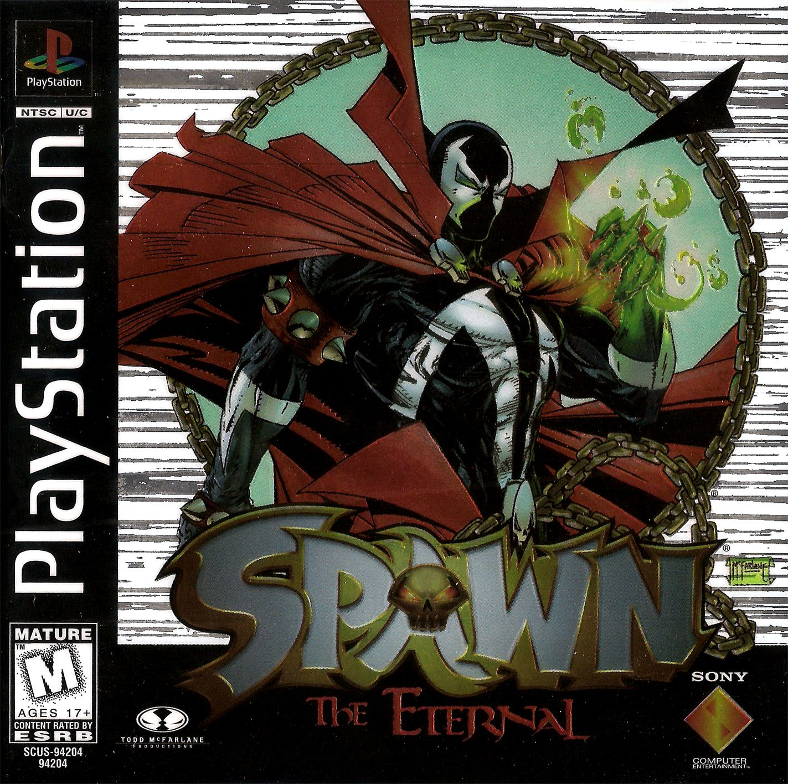
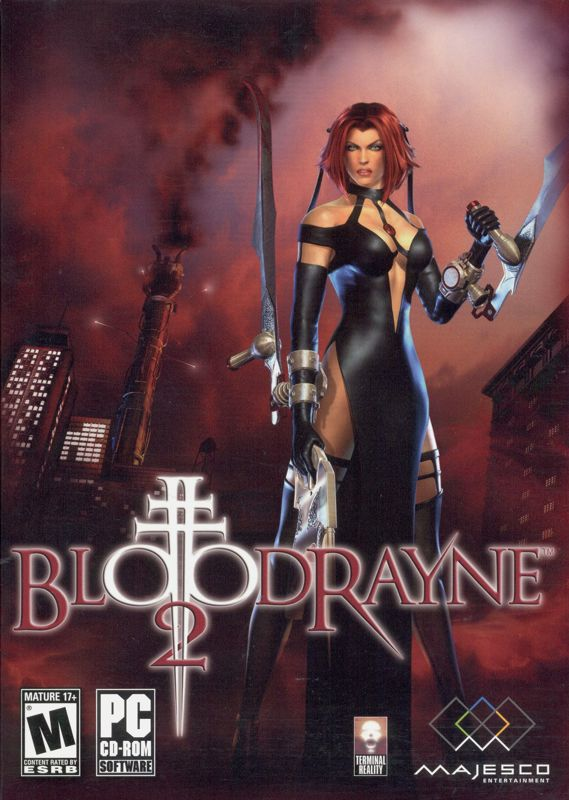

# bloodrayne2-spawn-the-eternal-psx
## Bloodrayne 2 — Spawn The Eternal PSX Remake
A total conversion project in Bloodrayne 2 remaking Spawn The Eternal PSX game in Bloodrayne 2 engine.

## GitHub Treeview
[https://treegit.macosxjs.com/?url=igiteam/bloodrayne2-spawn-the-eternal-psx](https://treegit.macosxjs.com/?url=igiteam/bloodrayne2-spawn-the-eternal-psx)

## GitHub Tree API (Direct JSON)
[https://api.github.com/repos/igiteam/bloodrayne2-spawn-the-eternal-psx/git/trees/main?recursive=1](https://api.github.com/repos/igiteam/bloodrayne2-spawn-the-eternal-psx/git/trees/main?recursive=1)

## Base of the gameplay

## WS11WineCX20.0.4 (macOS Big Sur 32-bit)

[WS11WineCX20.0.4.tar.7z](https://github.com/vitor251093/porting-kit-engines/releases/download/wineskin/WS11WineCX20.0.4.tar.7z)

## Reference links
[https://vimm.net/vault/54302(https://vimm.net/vault/54302)

[https://archive.org/details/bloodrayne-2-deviance](https://archive.org/details/bloodrayne-2-deviance)

---

# Welcome to br2proj

## Intro

br2proj is a new, modern, and open-source utility for processing Bloodrayne 2 game files.

This is implemented as an addon for [Blender](https://www.blender.org). Tested only on Blender 4.3.

Currently, it supports importing the following file formats:

1. **TEX** – Uncompressed raster images.
2. **SMB** – A format designed for storing 3D models. It turned out to be more complex than expected, as it includes animations and model variations at different levels of damage.
3. **BFM(with SKB)** – A mainstream 3D data format that uses skeletal structures and skeletal animation. It also supports gap meshes-special meshes that cover joints when a character is dismembered.

From now on, you can import these files directly into Blender!

And of course, feel free to open an issue. This is the place where you can share ideas for improvement as well as report any problems you encounter.

## How to install?
Open blender go to the `Scripting` tab, and just paste the contents of [build.py](https://github.com/PavelSharp/br2proj/blob/main/build.py), then click on the `run` button. Done.

This is a fairly clever script that will download and install the latest version itself automatically. 
You may need to enable `Allow Online Access` in `Edit`→`Preferences`→`System`, although my tests don't confirm this.  
If any exceptions have been generated, going to `Windows`→`Toggle System Console` should give detailed information on the progress of the execution

## How is it developed?
Visual Studio Code with [Blender Development](https://marketplace.visualstudio.com/items?itemName=JacquesLucke.blender-development)

## History
Almost 20 years ago, PodTools was a popular tool, but unfortunately, its development stopped in 2006. Support for animations (.ani files) was never completed, and the source code remained closed.

PodTools worked alongside BR_Tools (by BloodHammer) within gmax to enable exporting. For years, BR_Tools was considered lost-until KillerExe_01 published it [here](http://gamebanana.com/tools/18509).

Excited, I downloaded the archive, only to be disappointed once again - BR_Tools was also closed-source. However, the archive contained something valuable: the "BR2 3D FILE FORMATS DOCUMENT by BloodHammer(Mjolnir) (v1.19 - 15.01.2006)", which detailed past efforts to reverse-engineer the game's formats.

That was back in October 2024. At the time, I didn’t have the bandwidth to dive in, but starting in February 2025, I finally dedicated myself to building everything from scratch.

Now, I’m thrilled to share my progress with you!

## TODO
1. Animation import support (stored in .ani)
2. Export of these formats as far-reaching plans
3. Basic support for bloodrayne 1 as very far-reaching plans

## Dev Environment

**Official White Wii Remote With Nunchuk — Tested And Working — £14.99**
[https://www.ebay.co.uk/itm/800847189353](https://www.ebay.co.uk/itm/800847189353)

**Infrared Sensor Bar USB for Wii Emulator Remote Motion Detection Setup — £6.69**
[https://www.ebay.co.uk/itm/227423830875](https://www.ebay.co.uk/itm/227423830875)

**Apple MacBook Pro Retina 15in (2014) i7 2.8GHz 16GB 1TB SSD GT 750M — £120.30**
[https://www.ebay.co.uk/itm/800844561513](https://www.ebay.co.uk/itm/800844561513)

**WS11WineCX20.0.4 (Wine engine)**
[https://igiteam.github.io/wine_engines/](https://igiteam.github.io/wine_engines/)

**Official Genuine Sony PS3 PlayStation 3 DualShock 3 Wireless Controller Black — £19.99**
[https://www.ebay.co.uk/itm/840031043465](https://www.ebay.co.uk/itm/840031043465)

**Amazon Basics 4K HDMI Cable 3m — 18Gbps High Speed with Ethernet, 4K@60Hz, 2160p — £8.44**
[https://www.ebay.co.uk/itm/327352257557](https://www.ebay.co.uk/itm/327352257557)

**wiimote_nunchuk_macosx**
[https://github.com/igiteam/wiimote-nunchuk](https://github.com/igiteam/wiimote-nunchuk)

**xbox360_input_gui_py**
[https://github.com/igiteam/xbox360_input_gui_py](https://github.com/igiteam/xbox360_input_gui_py)

**logitec_mx_mouse_3_macos**
[https://github.com/igiteam/logitec_mx_mouse_3_macos](https://github.com/igiteam/logitec_mx_mouse_3_macos)

**igi1-macbook-3d-workstation**
[https://github.com/igiteam/igi1-macbook-3d-workstation](https://github.com/igiteam/igi1-macbook-3d-workstation)

---
